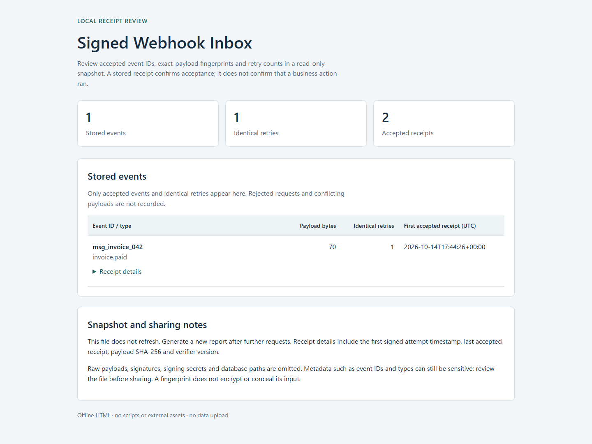

# Signed Webhook Inbox

Webhook retries can create duplicate invoice, subscription, or CRM updates. This
local integration reference verifies a signed event before writing it to SQLite,
acknowledges it only after commit, and keeps one immutable payload per event ID.
An identical retry succeeds; changed bytes under an existing ID return `409`.



[Linux setup and demo](#try-the-complete-scenario-on-linux) · [Persistent CLI](#run-a-persistent-inbox) · [Request contract](#request-contract) · [Checks](#verify-the-contracts) · [Source and limits](#design-and-limits)

## Try the complete scenario on Linux

There are no third-party runtime dependencies. Python 3.11 or newer and SQLite
3.37 or newer are required. The current Linux
walkthrough was tested on Ubuntu 24.04 under WSL2, Python 3.12.3 and SQLite
3.45.1. [Linux verification](docs/linux-verification.json) records the local
checks separately from the earlier source-composition record. From a fresh
checkout, install into a local virtual environment:

```sh
python3.12 -I -m venv .venv
.venv/bin/python -I -m pip install .
.venv/bin/python -I -m pip check
INBOX_CLI="$(pwd)/.venv/bin/signed-webhook-inbox"
INBOX_PYTHON="$(pwd)/.venv/bin/python"
```

Run the installed command from a separate working directory. The demo does not
need an account, a configured secret, a checkout-relative fixture or an external
service:

```sh
DEMO_WORKDIR="$(mktemp -d)"
cd "$DEMO_WORKDIR"
"$INBOX_CLI" demo --output-dir demo-review
"$INBOX_CLI" inspect --db demo-review/inbox.sqlite3
"$INBOX_CLI" report --db demo-review/inbox.sqlite3 --html second-review.html
```

The demo starts its own server on `127.0.0.1` with an OS-assigned port, sends
five requests, then stops the server. Open `demo-review/report.html` in a browser
to review the event, hash and retry count. See an [actual synthetic report](examples/report.html)
without running the CLI. Nothing opens a browser automatically.

| Retained file | Use |
| --- | --- |
| `inbox.sqlite3` | Inspect or restart the synthetic inbox. Contains its one raw synthetic payload. |
| `invoice-paid.json` | Reuse the exact synthetic body with `send`; included by the installed demo. |
| `inspect.json` | Metadata snapshot with one stored event and one identical retry. |
| `report.html` | Self-contained offline metadata view; no raw payload or signing material. |
| `outcomes.txt` | The five observed HTTP outcomes and deterministic summary below. |

`--output-dir` must name a new directory whose parent exists. Existing directories
and report files are never overwritten; choose a new name for another run.
Running `"$INBOX_CLI" demo` without flags preserves the original temporary demo:
it prints the same outcome lines and removes its temporary database on exit.
Timestamps refresh on each run; hashes and the outcome lines remain the same.
Actual output is also recorded in [docs/example-output.txt](docs/example-output.txt).

```text
valid: 200 stored
retry: 200 duplicate
tampered: 401 verification_failed
stale: 401 verification_failed
conflict: 409 conflict
events: 1
duplicate_count: 1
sha256: 1858de5efce540080ac8d1bff5d7d72501b0c8222ebd4573328de36d095f879b
```

## Run a persistent inbox

Create a new random key locally and keep it in the environment. The key must use
the `whsec_` prefix followed by padded Base64 for 24–64 random bytes. Continue
in the same Linux shell after the demo. Start the server in the background:

```sh
export WEBHOOK_SECRET="$("$INBOX_PYTHON" -c 'import base64,secrets; print("whsec_"+base64.b64encode(secrets.token_bytes(32)).decode())')"
"$INBOX_CLI" serve --db inbox.sqlite3 --port 8099 &
INBOX_PID=$!
```

Wait for `listening: http://127.0.0.1:8099/webhooks`, then send the retained
synthetic fixture twice from the same shell. Both commands inherit the same key:

```sh
"$INBOX_CLI" send --id msg_invoice_042 --payload-file demo-review/invoice-paid.json
"$INBOX_CLI" send --id msg_invoice_042 --payload-file demo-review/invoice-paid.json
"$INBOX_CLI" inspect --db inbox.sqlite3
"$INBOX_CLI" report --db inbox.sqlite3 --html inbox-review.html
```

The sender prints `{"status":200,"result":"stored"}` followed by
`{"status":200,"result":"duplicate"}`. `inspect` prints JSON with one event,
its original payload hash, byte count, receipt metadata, and `duplicate_count: 1`.
`report` reads the same metadata and writes a new HTML snapshot. Neither command
needs the signing key, changes stored events or creates a missing database.
The report omits raw bodies, signatures, secrets and database paths. Event IDs
and types can still be sensitive; review metadata before sharing.

Stop the background server after the requests finish:

```sh
kill "$INBOX_PID"
wait "$INBOX_PID" || true
unset WEBHOOK_SECRET
```

`kill` stops this background process; a foreground `serve` can be stopped with
`Ctrl+C`. Restarting with the same database keeps event IDs, even after a new
local key is configured. Retrying an existing ID still requires the exact original
body bytes. The server and sender use only loopback; there is no remote URL option.

For your own synthetic event, replace `--payload-file` with a local JSON file
matching the contract below. Use a separate database and key for any adaptation;
the retained demo database and fixture are examples.

## Request contract

Send `POST /webhooks` with exactly one each of `Content-Length`, `Content-Type`,
`webhook-id`, `webhook-timestamp`, and `webhook-signature`. The content type is
`application/json`, optionally with `charset=utf-8`. The body limit is 65,536
bytes. The total connection read deadline is five seconds, including headers;
SQLite lock waiting is bounded to one second.

An ID contains 1–128 ASCII letters, digits, underscores, or hyphens. The timestamp
is an integer Unix second. The SDK accepts attempts within five minutes of the
server's clock in either direction, so the clock must be accurate. Retries use
the same ID and exact body bytes with a fresh signed attempt timestamp.

The payload is a UTF-8 JSON object containing a `type` such as `invoice.paid` and
a `data` object. Event types contain dot-separated ASCII letters, digits, or
underscores, up to 128 characters. Other fields are preserved. Duplicate JSON
keys and nonstandard `NaN`/`Infinity` literals are rejected. JSON is validated
after signature verification, and the original bytes are stored without rewriting.

| Response | Meaning |
| --- | --- |
| `200 stored` | Verification and validation passed; a new row committed. |
| `200 duplicate` | Exact stored bytes matched; the retry counter committed. |
| `409 conflict` | A correctly signed request reused an ID with different bytes; the original row stayed unchanged. |
| `401 verification_failed` | Signature, UTF-8 verification input, or timestamp tolerance failed. |
| `400` | Malformed headers, framing, truncated body, or invalid JSON contract. |
| `411` / `413` | Missing length / body over the limit. |
| `415` / `417` | Unsupported media or encoding / unsupported `Expect`. |
| `408` | Body read deadline expired. A stalled or disconnected client may receive a closed connection instead. |
| `404` / `405` / `501` | Unknown route / explicitly rejected method / method not implemented by the development server. |
| `503 storage_unavailable` | Storage or commit failed; no success acknowledgment. Includes `Retry-After: 1`. |

Chunked requests, duplicate framing headers, compressed bodies, and
`Expect: 100-continue` are intentionally unsupported. Responses close the
connection. Methods not implemented by Python's development server, such as
`TRACE`, receive `501` with the JSON result `Not Implemented`. Only Standard Webhooks `v1`
symmetric signatures are verified; the
library may accept a valid `v1` alongside syntactically valid unknown versions.
This endpoint accepts `webhook-*` headers, not Svix's legacy `svix-*` aliases.

## Verify the contracts

```sh
.venv/bin/python -I -m pip install '.[dev]'
.venv/bin/python -m unittest discover -s tests -v
.venv/bin/python tools/source_contract.py original
.venv/bin/python tools/source_contract.py copy
.venv/bin/python -m ruff check .
.venv/bin/python -m ruff format --check .
.venv/bin/python -m build
```

Run these commands from the checkout. The suite uses real loopback HTTP for valid, tampered, stale, malformed,
duplicate, conflict, framing, deadline, and parallel-race cases. It exercises
real SQLite locks and trigger failures, injects a commit failure, and terminates
and restarts a CLI server process to check persistence. The demo is executed
twice to compare printed outcomes. Additional checks cover HTML escaping,
read-only failure for a missing database, retained outputs from another working
directory and refusal to overwrite existing output. CI uses pinned action commits
and dependencies. The [base revision's contracts run](https://github.com/skyon0522-ai/signed-webhook-inbox/actions/runs/38060147600)
passed at `a1e2cfa9dab431736bc4d38bb5febb649cc1c8e7`; this local candidate has
not run on GitHub. The unchanged upstream SDK tests can be run
against the source snapshot or the local copy with the receipt runner documented
in [REFERENCES.md](REFERENCES.md). The original-to-copy comparison and installed
wheel execution evidence are summarized in [VERIFICATION.md](VERIFICATION.md)
and [docs/verification.json](docs/verification.json).

## Design and limits

The pinned Standard Webhooks 1.1.0 source is copied unchanged into this package
and executes for verification and signing. This assembly reuses the existing
inbox extension for HTTP limits, a small JSON contract, durable deduplication,
and read-only inspection. Its source lineage is recorded in
[SOURCE_MANIFEST.json](SOURCE_MANIFEST.json).

The [receiver](src/signed_webhook_inbox/server.py) verifies requests, the
[storage layer](src/signed_webhook_inbox/storage.py) commits or deduplicates them,
and the [CLI](src/signed_webhook_inbox/cli.py) runs the demo and local server.
See [architecture](docs/architecture.md), [source provenance](REFERENCES.md),
[tests](tests/) and [verification](VERIFICATION.md) for the corresponding boundaries.

See [architecture](docs/architecture.md), [reference provenance](REFERENCES.md),
and [third-party notices](THIRD_PARTY_NOTICES.md). Each ID represents one stored
event, not exactly-once execution of business side effects. The HTML report is
a static receipt snapshot. There is no consumer, queue, delivery service, live
dashboard, key rotation manager, or remote integration.

SQLite uses WAL and `synchronous=FULL`; actual crash durability still depends on
the filesystem and hardware honoring synchronization. Keep the database and its
WAL files together; stop the process before a file copy or use SQLite's backup
API. IDs are retained indefinitely. The database contains raw event data and
must be protected with local file permissions. Payloads, signatures, and secrets
are not logged by the receiver; `inspect` prints only metadata.

Python's development HTTP server, unbounded request threads, plain loopback HTTP,
and a single configured key are deliberate local-demo limits. No public hosting,
provider account, customer deployment, or revenue result is demonstrated here.

## Research background

[RESEARCH.md](RESEARCH.md) relates the selected HMAC construction and signed
message fields to the original HMAC paper and Standard Webhooks specification.
It separates cryptographic background from this application's storage and HTTP checks.
